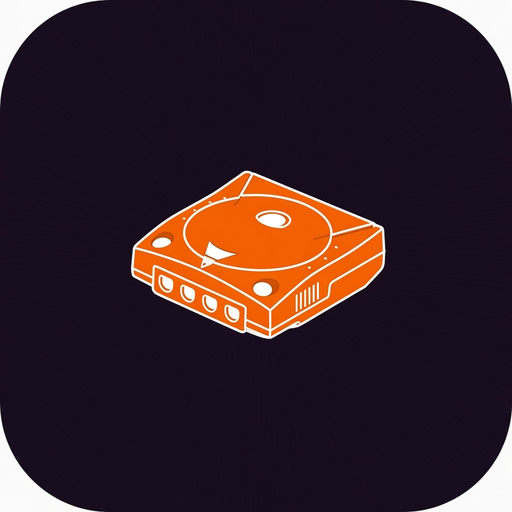

# Sega Dreamcast Documentation Repository

  

Curated **offline** collection of Sega Dreamcast engineering specs, programmer guides, manuals, and reverse-engineering notes. Binary manuals live under [`files/`](files/).

## Local Primary Sources (under `files/`)

### Official hardware & standards
- [Dreamcast Hardware Specification Outline](files/official/Dreamcast_Hardware_Specification_Outline.pdf) (~40 pp., 1999)
- [Dreamcast/Dev.Box System Architecture](files/official/DreamcastDevBoxSystemArchitecture.pdf) (407 pp., Rev 99/09/02)
- [Software Creation Standards Guidebook](files/official/scstandards.pdf)
- [AICA Sound-block User's Manual](files/official/AICA_E.pdf) (`AICA_E.pdf`)
- [Peripheral hardware (controller) 01_sdhwr](files/official/01_sdhwr100e.pdf)
- [VMS / VMU related](files/official/02_VMS100e.pdf)
- [SH-4 access notes](files/official/SH4_access990312_e.pdf)
- [Ft6 tech note](files/official/Ft6_090e.pdf)

- [Hardware outline (Word, Kochise)](files/hardware/E_DC_HW_outline.doc)
- [DC Schematic](files/hardware/DC%20Schematic.pdf)
- [Sega Dreamcast Game Console BPT](files/hardware/Sega_Dreamcast_Game_Console-BPT.pdf)

### SH-4 (Hitachi)
- [Programming Manual](files/sh4/h14tp003d2.pdf) (`h14tp003d2.pdf`)
- [Hardware Manual](files/sh4/h14th002d2.pdf) (`h14th002d2.pdf`)
- [Product Overview](files/sh4/h14sf001d2.pdf) (`h14sf001d2.pdf`)

### AICA (Yamaha) + ARM7TDMI references
- Community notes: [`files/aica/aica.txt`](files/aica/aica.txt), [`files/aica/aica_v08.txt`](files/aica/aica_v08.txt)
- ARM7 manuals (for the embedded ARM7DI core): see PDFs in [`files/aica/`](files/aica/)

### Maple / peripherals
- [Maple patent PDF](files/maple/MaplePatent.pdf)
- [VMU](files/vmu/vmu.pdf)

### GD-ROM
- Manuals and controller datasheets in [`files/gdrom/`](files/gdrom/) (incl. `gdrom-manual.pdf`, OTI/CXD parts)

### PowerVR / graphics notes
- Full set under [`files/powervr/`](files/powervr/) (portal techniques, feature overviews, related MBX/PDP docs)

### G2 bus / expansion
- [`files/g2bus/`](files/g2bus/)

### Community RE (offline HTML)
- Marcus Comstedt mirror pages: [`files/mcpp/`](files/mcpp/) (`cpu.html`, `maplebus.html`, `gdrom.html`, `pvr.html`, …)
- Copetti Dreamcast architecture article: [`files/mcpp/copetti-dreamcast.html`](files/mcpp/copetti-dreamcast.html)

### Full Kochise tree (too large for git)
Complete Kochise dreamcast-docs mirror (including multi-GB SDK dumps) is kept on this machine at:

`/mnt/storage/models/archive/docs-mirrors/Kochise-dreamcast-docs`

Curated PDFs from that tree were copied into `files/` above.

## Official Sega Documentation (indexed)

### Hardware Specifications
- Dreamcast Hardware Specification Outline — see local PDF above.
- Dreamcast/Dev.Box System Architecture — see local PDF above.

### Katana SDK / Development Libraries
Multiple revisions exist historically (0.20 Pre.7 through R9, Shinobi/Kamui sources, WinCE Toolkit). Full SDK archives are in the Kochise storage mirror under `SDK/` (not committed to this git repo due to size ~3.8 GB).

### Software Standards
- Local: [`files/official/scstandards.pdf`](files/official/scstandards.pdf)

### Component Manuals
- SH-4, AICA ARM7 refs, Maple, GD-ROM — all under `files/` as listed above.

## Hardware (summaries in this repo)

| Component | Summary MD | Local manuals |
|-----------|------------|---------------|
| SH-4 | [`hardware/sh4.md`](hardware/sh4.md) | `files/sh4/*` |
| HOLLY / PowerVR2 | [`hardware/holly.md`](hardware/holly.md) | `files/powervr/*`, official outline |
| AICA | [`hardware/aica.md`](hardware/aica.md) | `files/aica/*` |
| GD-ROM | [`hardware/gdrom.md`](hardware/gdrom.md) | `files/gdrom/*` |
| Maple | [`hardware/maple.md`](hardware/maple.md) | `files/maple/*` |
| Memory map | [`hardware/memory.md`](hardware/memory.md) | official + `files/mcpp/memory.html` |

## Software & Development

- Official Katana materials: storage Kochise `SDK/`
- Homebrew: see [`software/kos.md`](software/kos.md) (KallistiOS is living upstream; not vendored)

## Reverse Engineering

See [`reverse-engineering/quirks.md`](reverse-engineering/quirks.md) and offline Comstedt/Copetti HTML under `files/mcpp/`.

## Tools

- Emulators for RE validation: [`tools/emulators.md`](tools/emulators.md)

## Service manuals and VA0 schematics

Sega Europe after-sales manual and the VA0 sheet set, from the RetroTechCollection wiki (the service manual scan originates in the Internet Archive item `dreamcast-service-manual`):

| Document | Local file |
|----------|------------|
| Service Manual: Dreamcast EU, No. 022-EU (October 1999, VA1) | [`files/service/Sega_Dreamcast_EU_Service_Manual_022-EU.pdf`](files/service/Sega_Dreamcast_EU_Service_Manual_022-EU.pdf) |
| VA0 block, clock, reset | [`files/service/`](files/service/) `Sega_Dreamcast_VA0_Block_Diagram.pdf`, `Sega_Dreamcast_Clock_Diagram.pdf`, `Sega_Dreamcast_Reset_Diagram.pdf` |
| VA0 CPU/DRAM, GPU/VRAM, video DAC, ROM/flash/IO, connectors, sound/clock, power supply (837-13570), exploded view | [`files/service/`](files/service/) |

The EU manual covers disassembly, VA1 schematics, IC pinouts, and parts lists. It does not include a power-supply parts list. The VA0 power-supply sheet is the separate one-page PDF above.

Early VA0 boards (circled 0 on the bottom sticker, heat-pipe cooler) take a 5 V BIOS flash. VA1 and VA2.1 boards take a 3.3 V flash. That distinction is repair practice from the archived mmmonkey region-free BIOS notes, not a line in the 022-EU scan. No separate public Japanese service-manual PDF turned up on this pass. The Internet Archive item `dreamcast-service-manual` is a 7.2 GB rar and was left unpacked.

## Kochise manuals not in the first harvest

Official Sega Word/PDF docs copied out of the on-disk Kochise tree (`/mnt/storage/models/archive/docs-mirrors/Kochise-dreamcast-docs`). The multi-gigabyte `SDK/` tree and KOS source stay on disk only.

| Set | Local path |
|-----|------------|
| Peripherals (gun, keyboards, Dreameye, mouse, mic, vibration, fishing, Maple, Ft0–Ft11) | [`files/kochise/CONTROLR/DOCS/`](files/kochise/CONTROLR/DOCS/) |
| GD-ROM format / CD interface (Word) | [`files/kochise/GDROM/DOCS/`](files/kochise/GDROM/DOCS/) |
| Broadband adapter + RTL8139 | [`files/kochise/LAN/DOCS/`](files/kochise/LAN/DOCS/) |
| Modem chipset datasheets | [`files/kochise/MODEM/DOCS/`](files/kochise/MODEM/DOCS/) |
| Holly interrupt note, Kamui, TA / PowerVR register notes | [`files/kochise/POWERVR/DOCS/`](files/kochise/POWERVR/DOCS/) |
| SH7750 hardware manual (`e602124`), `sh7750h`, `e602156` (ADE-602-156D Rev. 5.0, 2001-04-19), SH-4 limit note | [`files/kochise/CPU/DOCS/`](files/kochise/CPU/DOCS/) |
| SH-4 Software Manual, Renesas REJ09B0318 Rev. 6.00 (2006-09-13) | [`files/kochise/CPU/DOCS/REJ09B0318-SH-4-Software-Manual-Rev6.00.pdf`](files/kochise/CPU/DOCS/REJ09B0318-SH-4-Software-Manual-Rev6.00.pdf) |
| SH-4 CPU core architecture, SuperH Inc. 04-CC-10001 V1.0 (2002-05-27, cover marked preliminary) | [`files/kochise/CPU/DOCS/SH-4-CPU-Core-Architecture-04-CC-10001.pdf`](files/kochise/CPU/DOCS/SH-4-CPU-Core-Architecture-04-CC-10001.pdf) |
| SH7750 errata that name HD6417750 or SH7750 | [`files/kochise/CPU/ERRATA/`](files/kochise/CPU/ERRATA/) |
| Serial coder-cable schematic | [`files/kochise/SERIAL/SCHS/dccircuit.pdf`](files/kochise/SERIAL/SCHS/dccircuit.pdf) |

## Coverage Note

This repository keeps **offline PDFs and HTML** for the core official and community manuals. Large SDK dumps stay on local storage only. Markdown under `hardware/`, `software/`, `tools/`, and `reverse-engineering/` summarizes and indexes the local files.

Last updated: 2026-10-12 — EU service manual, VA0 schematics, Kochise peripheral docs, the 2006 SH-4 software manual, and the SH7750 errata. SH7750R-only, SH7751-only, SH-4A, and SH-5 sheets stay on the Kochise disk.
